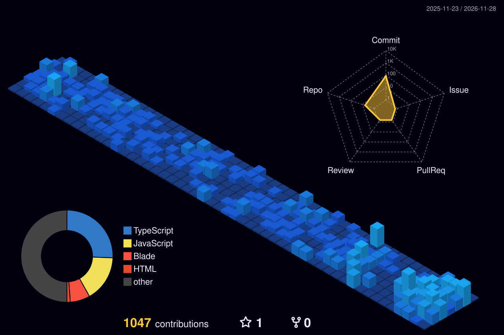

<!-- Animated Wave Hero Banner -->

  

<!-- Social Bar -->

  
  
  
  

<!-- Subtle Glowing Horizon Divider -->

  

 

## 👨‍💻 About Me

<!-- Animated Multi-Line CLI Profile Readout -->

  

<!-- Single-Row Core Focus Strip -->

  
  
  

  <i>"The science of today is the technology of tomorrow." — Edward Teller</i>

 

## 🛠️ Tech Stack

  
<b>FRONTEND, MOBILE & DESIGN</b>

  
    
  
<b>BACKEND, DATABASES & TOOLING</b>

  

 

## 🚀 Selected Work

  
  

  
  

 

  

 

## 📊 GitHub Insights

  
  

 

  

 

## 📈 Contribution Graph

  

 

## 📫 Let's Connect

<!-- Subtle Glowing Horizon Divider -->

  

 

  
Open to collaborating on full-stack web, mobile, and software engineering projects. 
  Drop a message anytime at <a href="mailto:mahmudsets@gmail.com"><b>mahmudsets@gmail.com</b></a>

  

 

<!-- Matching Footer Wave -->

  

